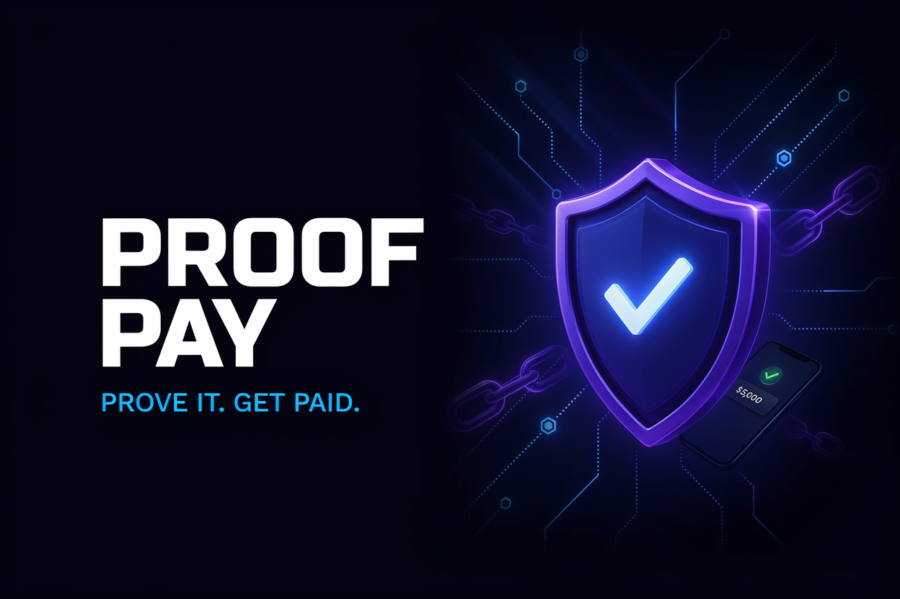

<div align="center">



# 💸 ProofPay

**Trustless task payment platform — prove your work, get paid automatically on the XION blockchain**

[](https://expo.dev)
[](https://typescriptlang.org)
[](https://xion.burnt.com)
[](LICENSE.md)

🏆 Checkpoint 1 Winner — XION Proof of Concept Hackathon (selected from 2000+ participants)

</div>

<br/>

ProofPay is a trustless task payment platform supporting Soft, zkTLS, and Hybrid proof systems on the XION blockchain. Create tasks, submit verifiable proofs, and get paid automatically — cryptographic verification for objective work, manual review for subjective work, and a hybrid approach for complex scenarios.

## ✨ Features

- **Soft Proofs** — manual review for subjective work (content creation, design, consulting)
- **zkTLS Proofs** — cryptographic verification of API responses via the XION Dave SDK (instant, zero human review)
- **Hybrid Proofs** — zkTLS verification plus a manual review window with auto-release timer for complex tasks
- **Abstraxion wallet auth** — seamless XION wallet connection and smart contract interaction
- **Real-time updates** — live task status changes via Supabase Realtime
- **Push notifications** — OneSignal integration for mobile alerts on task updates
- **Evidence uploads** — signed URL secure file storage for photo and document proofs

## 🎥 Demo

[](https://www.youtube.com/watch?v=j0CIWGTbssI)

## 🛠️ Tech Stack

| Layer | Technology |
|---|---|
| Framework | React Native + Expo Router |
| Language | TypeScript |
| Blockchain | XION (smart contract integration) |
| Wallet | Abstraxion (XION wallet auth) |
| Verification | XION Dave SDK (zkTLS) |
| Backend | Supabase (PostgreSQL + Realtime) |
| Notifications | OneSignal |

## 🚀 Getting Started

```bash
npm install
```

Copy `.env.example` to `.env` and fill in your values, then:

```bash
npx expo start
```

Open in Expo Go by scanning the QR code, or press `i` for iOS / `a` for Android.

### Demo mode (one command)

```bash
npm run demo:setup
```

Starts the blockchain indexer (port 3001), mock zkTLS verifier (port 3002), the React Native app with test data, and Supabase Realtime sync. Full walkthrough in [DEMO.md](DEMO.md).

## 📄 License

MIT — see [LICENSE.md](LICENSE.md) for details.
